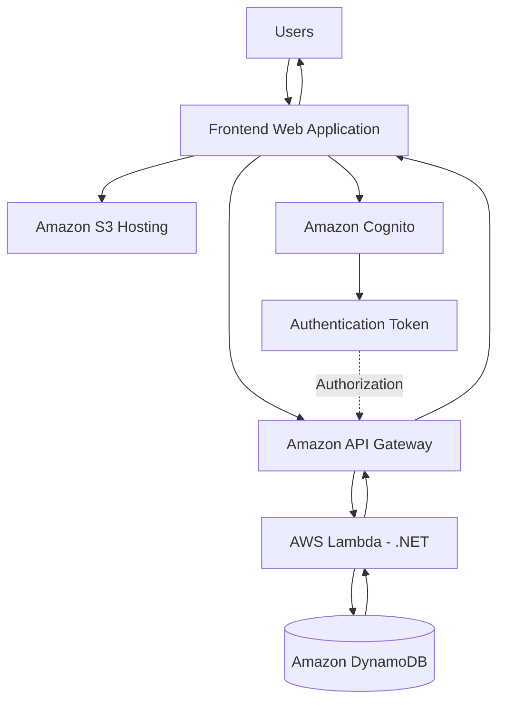

# 🚀 Serverless Appointment Booking System

### Modernizing a Legacy .NET Application into a Cloud-Native AWS Serverless Architecture

<p align="center">
  
  
  
  
  
</p>

---

## 📖 Project Overview

This project demonstrates the modernization of a locally hosted legacy .NET appointment booking application into a cloud-native, serverless architecture using Amazon Web Services (AWS).

The original application relied on traditional server-based hosting, which introduced infrastructure management overhead, scaling limitations, and operational costs.

To address these challenges, I re-architected the application using AWS managed services and serverless computing.

The modernized solution uses **AWS Lambda with .NET (C#), Amazon API Gateway, Amazon Cognito, Amazon DynamoDB, and Amazon S3** to deliver a scalable, flexible, and cost-efficient appointment booking platform.

The architecture eliminates the need to provision and maintain application servers while allowing backend functions to scale automatically based on incoming requests.

This project demonstrates practical cloud application modernization, serverless backend development, managed authentication, and cloud-native application architecture.

## 🎯 Problem Statement

Traditional application hosting introduces several challenges as business requirements and user traffic grow.

The legacy appointment booking application faced challenges such as:

- **Infrastructure Dependency:** Application deployment and execution depended on locally hosted servers.
- **Limited Scalability:** Handling increased appointment requests required additional infrastructure capacity and manual intervention.
- **Operational Overhead:** Server maintenance, configuration, monitoring, and infrastructure management required additional effort.
- **Fixed Infrastructure Costs:** Resources needed to remain available even during periods of low application usage.
- **Traditional Authentication Management:** Application authentication and user management required application-side responsibilities.

These limitations motivated the migration toward a cloud-native serverless architecture.

## 💡 Solution: AWS Serverless Modernization

The application was redesigned using AWS managed services, replacing traditional application server hosting with a serverless execution model.

Instead of maintaining continuously running application servers, the backend business logic executes through AWS Lambda functions.

Amazon API Gateway provides the API entry point, Amazon Cognito handles user authentication, and DynamoDB provides scalable NoSQL data storage.

The frontend is hosted as a static web application using Amazon S3.

### Key Architectural Improvements

- Eliminated application server provisioning and maintenance.
- Enabled automatic compute scaling through AWS Lambda.
- Adopted managed authentication using Amazon Cognito.
- Introduced serverless NoSQL data storage using DynamoDB.
- Separated frontend hosting from backend application execution.
- Adopted a usage-based cloud infrastructure model.
- Reduced operational responsibilities through AWS managed services.

---

## 🏗️ System Architecture

The application follows a serverless client-server architecture.

### 1. Frontend Layer

**Amazon S3**

- Hosts the static frontend application.
- Separates frontend deployment from backend execution.
- Provides scalable object storage for frontend assets.

### 2. API and Application Layer

**Amazon API Gateway**

- Exposes RESTful API endpoints.
- Receives incoming application requests.
- Integrates with AWS Lambda functions.

**AWS Lambda (.NET / C#)**

- Executes backend business logic.
- Processes appointment-related operations.
- Handles application requests without requiring dedicated application servers.
- Scales execution based on incoming demand.

### 3. Authentication Layer

**Amazon Cognito**

- Manages user registration and authentication.
- Provides managed identity services.
- Supports authentication and authorization integration with application APIs.

### 4. Data Layer

**Amazon DynamoDB**

- Stores appointment and user-related application data.
- Provides managed NoSQL database capabilities.
- Supports low-latency data access.

### High-Level Architecture Diagram



*The diagram represents the high-level logical architecture. Actual authorization configuration and integration details depend on the deployed API setup.*

---

## ✨ Key Features

### 🔐 Secure Authentication & Authorization

Integrated Amazon Cognito to manage user authentication.

- User registration and sign-in.
- Managed identity and authentication.
- Token-based authentication integration.
- Centralized user identity management.

### 📅 Appointment Management

A serverless backend for managing appointment-related operations.

- Create appointments.
- Retrieve appointment information.
- Update existing appointments.
- Cancel appointments.
- Store and retrieve appointment data using DynamoDB.

### ⚡ Serverless API Processing

AWS Lambda powers the backend application.

- Execute .NET business logic through Lambda.
- Integrate backend functions with API Gateway.
- Scale compute execution automatically.
- Eliminate traditional application server management.

### 🗄️ Serverless Database

Amazon DynamoDB provides the persistence layer.

- Managed NoSQL storage.
- Scalable data access.
- Flexible data modeling.
- Integration with Lambda-based application logic.

### ☁️ Cloud-Based Frontend Hosting

Amazon S3 hosts the static frontend application.

- Static website asset hosting.
- Independent frontend deployment.
- Separation of presentation and application layers.

### 💰 Usage-Based Infrastructure

The architecture uses AWS managed services with consumption-based pricing models.

- No continuously running application servers are required.
- Compute costs are based on Lambda execution.
- Database and storage costs depend on resource usage.
- Infrastructure can scale with application demand.

---

## 🛠️ Technology Stack

### Backend Development

| Technology | Purpose |
|---|---|
| C# | Backend application development |
| .NET | Application runtime and business logic |
| AWS Lambda | Serverless backend execution |
| Amazon API Gateway | REST API management |

### Frontend & Hosting

| Technology | Purpose |
|---|---|
| TypeScript | Frontend application development |
| JavaScript | Client-side functionality |
| Amazon S3 | Static frontend hosting |

### Authentication & Database

| Technology | Purpose |
|---|---|
| Amazon Cognito | User authentication and identity management |
| Amazon DynamoDB | NoSQL database |
| IAM | AWS permissions and access management |

### Cloud Architecture

- AWS Serverless Architecture
- Cloud-Native Application Modernization
- Managed Cloud Services
- Environment-Based Configuration

---

## 🔄 Legacy Architecture vs Modernized Architecture

One of the main objectives of this project was to demonstrate how an existing server-based application can be modernized using cloud-native technologies.

| Aspect | Legacy Application | Modernized Application |
|---|---|---|
| Hosting | Local / On-Premise | Amazon S3 and AWS Lambda |
| Backend Execution | Server-Based .NET | Serverless .NET Lambda |
| API Management | Traditional Application Hosting | Amazon API Gateway |
| Authentication | Application-Side Management | Amazon Cognito |
| Database | Traditional Database Approach | Amazon DynamoDB |
| Scaling | Infrastructure-Dependent | Automatic Lambda Scaling |
| Infrastructure | Server Maintenance Required | Managed AWS Services |
| Cost Model | Infrastructure-Based | Usage-Based Services |

---

## 🔍 Serverless Architecture Concepts Demonstrated

This project provides practical experience with several important cloud architecture concepts.

### 1. Serverless Computing

Using AWS Lambda to execute application business logic without provisioning or managing application servers.

### 2. Managed API Architecture

Using Amazon API Gateway as the API entry point and integration layer for backend Lambda functions.

### 3. Managed Authentication

Using Amazon Cognito to separate user identity management from application business logic.

### 4. NoSQL Database Architecture

Using Amazon DynamoDB for scalable application data persistence.

### 5. Separation of Concerns

Separating frontend hosting, backend execution, authentication, and data storage into independently managed cloud services.

### 6. Cloud Application Modernization

Transforming an existing legacy application into a cloud-native architecture without relying on traditional application server hosting.

---

## 📂 Repository Structure

```text
aws-serverless-appointment-system/
│
├── Api/
│   └── .NET backend and AWS Lambda application
│
├── Frontend/
│   └── Frontend application
│
└── README.md
```

---

## 📚 Additional Learning Resource: Event-Driven Architecture with AWS Lambda

Serverless computing is not limited to handling HTTP API requests.

AWS Lambda can also execute automatically in response to events generated by other AWS services.

I have created a separate practical demonstration to help developers understand how Lambda can be used as part of an event-driven architecture.

### 🎥 Watch the Event-Driven Architecture Demonstration

[](https://youtu.be/ydHVK8zW844)

**Watch on YouTube:** https://youtu.be/ydHVK8zW844

This is a separate project and learning example, not an implementation component of this appointment booking system.

### What You Can Learn

- How event-driven architecture works.
- How AWS Lambda responds to events.
- How event-based processing differs from traditional synchronous API execution.
- How serverless functions can be used to build loosely coupled application workflows.
- How event-driven patterns can help build scalable cloud-native systems.

### Understanding the Difference

| API-Driven Architecture | Event-Driven Architecture |
|---|---|
| Triggered by API requests | Triggered by events |
| Often synchronous | Often asynchronous |
| API Gateway can invoke Lambda | AWS services can invoke Lambda |
| Returns an API response | Processes events independently |

Both architectural approaches are valuable when designing modern cloud applications. AWS supports both direct service integrations and event-source-based Lambda execution.

---

## 🚀 Future Enhancements

Potential improvements for extending this application include:

- Infrastructure as Code using AWS CDK or Terraform.
- CI/CD automation using GitHub Actions.
- Advanced appointment scheduling and availability management.
- Event-driven appointment notifications.
- Appointment reminders using Amazon EventBridge Scheduler.
- Asynchronous processing using Amazon SQS.
- Centralized logging and monitoring using Amazon CloudWatch.
- Distributed tracing and observability.
- Enhanced API security and request validation.
- Automated deployment across development, staging, and production environments.

---

## 🎓 What This Project Demonstrates

This project demonstrates practical experience in:

- Legacy application modernization.
- AWS cloud architecture design.
- Serverless application development.
- .NET and C# backend development.
- AWS Lambda integration.
- RESTful API development.
- Amazon Cognito authentication.
- DynamoDB data modeling and integration.
- Cloud-based frontend hosting.
- Cost-aware cloud architecture design.

The main architectural objective was to move away from traditional server-dependent application hosting and adopt a more scalable, maintainable, and operationally efficient cloud-native solution.

---

## 👨‍💻 Developer

**Oshan Mihiraj Wijesooriya**

Software Engineer | .NET | AWS | Cloud Architecture

- GitHub: https://github.com/Omihiraj
- YouTube: https://www.youtube.com/@Omihiraj

---

⭐ If you find this project interesting, consider giving this repository a star!

