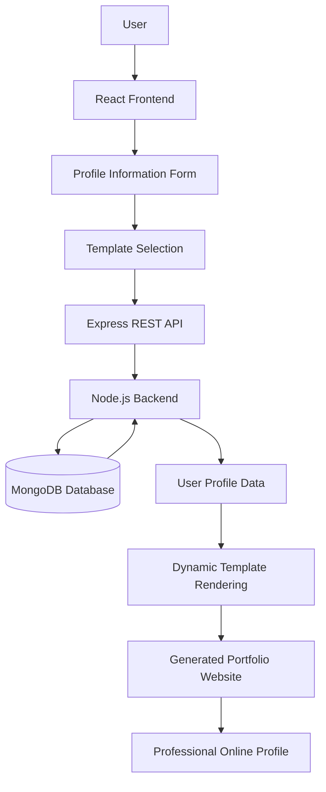

# 🚀 Dynamic CV & Portfolio Generator

### Create Your Professional Resume & Personal Portfolio Website Without Coding

A full-stack web application that allows users to create personalized CVs and professional portfolio websites dynamically. Users can enter their personal and professional information, select from available design templates, and generate a customized portfolio website using their own details.

The platform simplifies the process of building an online professional identity by eliminating the need to manually design and develop a personal website.

---

## 📌 Project Overview

In today's competitive job market, having a professional CV and an online portfolio is essential for showcasing skills, qualifications, work experience, and professional achievements.

However, creating a well-designed CV and personal portfolio website often requires technical knowledge, design skills, and considerable development time.

To address this challenge, I developed a **Dynamic CV & Portfolio Generator System**.

The application allows users to provide their professional information through a web interface and choose from predefined website templates. Based on the selected template and submitted information, the system dynamically generates a personalized CV and portfolio website.

Instead of developing a personal website from scratch, users can create their own professional online presence through a simple and user-friendly process.

## 🎯 Project Objectives

- Simplify the process of creating professional CVs and portfolio websites.
- Allow users to build their professional profiles without programming knowledge.
- Provide multiple predefined website templates.
- Dynamically generate personalized websites using user-provided information.
- Separate content management from website presentation.
- Reduce the time and effort required to develop a personal portfolio website.
- Provide a flexible platform that can be extended with additional templates and features.

## ✨ Key Features

### 📝 Dynamic Profile Management
- Enter personal and professional information.
- Add educational qualifications and work experience.
- Showcase technical skills and professional achievements.
- Manage information used to generate the portfolio.

### 🎨 Multiple Website Templates
- Choose from available portfolio design templates.
- Customize the appearance of the generated professional website.
- Use predefined layouts without manually writing HTML or CSS.

### ⚡ Dynamic Website Generation
- Generate a personalized portfolio website using submitted user information.
- Populate the selected template with the user's professional details.
- Separate portfolio content from its visual presentation.
- Create a professional online presence without developing a website from scratch.

### 💼 Professional Portfolio Presentation
- Present personal and professional information in an organized format.
- Showcase qualifications, experience, and skills.
- Provide a dedicated professional portfolio experience.

### 🌐 Full-Stack Web Application
- React-based frontend application.
- Node.js and Express.js backend.
- MongoDB database integration.
- REST API-based client-server communication.

## 🏗️ System Architecture

The application follows a client-server architecture with three main components.

1. **Frontend Application:** Provides the user interface for entering information, navigating the application, and selecting portfolio templates.
2. **Backend Application:** Handles API requests, application logic, and communication with the database.
3. **Database Layer:** Uses MongoDB to manage application data through Mongoose.

### High-Level Architecture



## 🔄 How It Works

The general user workflow is designed to be simple:

1. The user accesses the CV & Portfolio Generator application.
2. The user enters personal information and professional details.
3. The user provides information about education, skills, and work experience.
4. The user selects a preferred portfolio website template.
5. The frontend communicates with the backend through REST APIs.
6. The backend processes the submitted information and interacts with MongoDB.
7. The selected template is populated with the user's information.
8. The system generates a personalized professional portfolio website.

## 🛠️ Technologies Used

### Frontend

| Technology | Purpose |
|---|---|
| React.js 18 | Component-based frontend development |
| React Router | Client-side navigation |
| Tailwind CSS | UI styling |
| CSS3 | Custom styling |
| React Icons | Interface icons |
| React Slick | Carousel and slider functionality |
| JavaScript | Frontend application logic |
| HTML5 | Web application structure |

### Backend

| Technology | Purpose |
|---|---|
| Node.js | Server-side JavaScript runtime |
| Express.js | REST API development |
| Mongoose | MongoDB object modeling |
| CORS | Cross-origin communication |
| dotenv | Environment configuration |
| express-async-handler | Asynchronous request handling |
| colors | Development console output |

### Database

- MongoDB

## 📂 Project Structure

```text
CV-Portfolio-Generator/
│
├── client/
│   ├── public/
│   ├── src/
│   │   ├── components/
│   │   ├── pages/
│   │   ├── App.js
│   │   └── ...
│   └── package.json
│
├── Server/
│   ├── config/
│   │   └── db.js
│   ├── middleware/
│   │   └── errorMiddleware.js
│   ├── routes/
│   │   └── userRoutes.js
│   └── server.js
│
├── package.json
├── package-lock.json
└── README.md
```

## ⚙️ Installation & Setup

Follow these steps to run the project locally.

### Prerequisites

Make sure you have installed:

- Node.js
- npm
- MongoDB (local installation or MongoDB Atlas)
- Git

### 1. Clone the Repository

```bash
git clone https://github.com/Omihiraj/CV-Portfolio-Generator.git

cd CV-Portfolio-Generator
```

### 2. Install Backend Dependencies

From the project root directory:

```bash
npm install
```

### 3. Configure Environment Variables

Create a `.env` file in the root directory.

Configure the required environment variables according to the database connection implementation in `Server/config/db.js`.

Example:

```env
PORT=8000
MONGO_URI=your_mongodb_connection_string
```

### 4. Start the Backend Server

```bash
npm start
```

For development with automatic server restarting:

```bash
npm run server
```

The backend uses port `8000` by default unless another port is configured.

### 5. Install Frontend Dependencies

Open a new terminal:

```bash
cd client

npm install
```

### 6. Start the Frontend Application

```bash
npm start
```

The React development server will start, typically at:

```text
http://localhost:3000
```

Make sure the frontend API configuration points to the running backend server.

## 🌟 Project Highlights

This project demonstrates the practical application of full-stack web development concepts, including:

- Building reusable React components.
- Developing RESTful APIs using Express.js.
- Integrating MongoDB with Mongoose.
- Implementing client-server communication.
- Managing dynamic user-provided information.
- Creating template-driven web applications.
- Separating frontend presentation from backend processing.

## 🚀 Future Enhancements

Potential improvements to extend the platform:

- Additional professional CV and portfolio templates.
- Live portfolio preview while editing information.
- Custom domain support for generated portfolio websites.
- PDF CV generation and downloading.
- Drag-and-drop portfolio customization.
- Public portfolio sharing through unique URLs.
- Social media and GitHub profile integration.
- AI-assisted CV content improvement.
- Responsive templates optimized for mobile devices.
- User dashboard for managing multiple CVs and portfolios.

## 👨‍💻 Developer

**Oshan Mihiraj Wijesooriya**

Software Engineer | Full-Stack Development | Software Architecture

GitHub: [@Omihiraj](https://github.com/Omihiraj)

---

⭐ If you find this project interesting, consider giving this repository a star!

